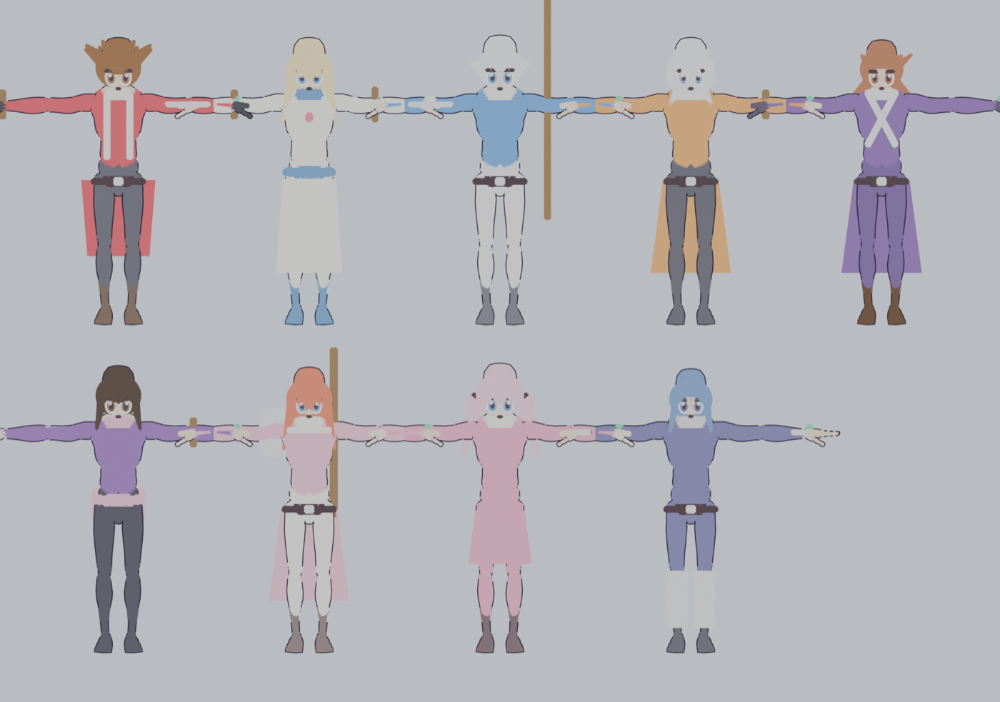

# Tales of Symphonia — Remake fan (Godot 4)

Remake fan de *Tales of Symphonia* (GameCube, 2003) en Godot 4.7, con estética cel-shaded inspirada en *Tales of Vesperia*.
**Demo jugable: Capítulo 1, de Iselia al Desierto de Triet.**

## Qué incluye la demo
- Historia del capítulo 1 escena por escena (`docs/STORY_C1.md`): clase de Raine, oráculo, Templo de Martel (Botta, Vidarr,
  Kratos, Remiel), rancho de Iselia (Marble), casa de Dirk, ataque desiano (Forcystus, Exbelua), destierro, Casa de la
  Salvación, llegada a Triet y pantalla de fin de demo.
- Combate LMBS en tiempo real: combos, artes con coreografía (Demon Fang, Sonic Thrust, Tiger Blade, Sword Rain,
  Tempest, Beast…), hechizos por elemento, guardia, Over Limit, Unison Attack, objetos en combate, Grado.
- Sistemas: tienda, posada, equipo (6 huecos), cocina y Maestro Cocinero, títulos, EX Skills/EX Gems, skits,
  Anillo del Hechicero, guardado en 3 ranuras con Círculos de Memoria (`docs/SYSTEMS.md`).
- 24 modelos propios generados por script en Blender, banda sonora original (13 pistas) y 42 efectos sintetizados.

## Jugar
- **Windows**: descarga el zip de [Releases](../../releases), descomprime y abre `TalesOfSymphonia.exe`.
- **Desde el código**: Godot 4.7.2 → abre el proyecto o `godot --path .`

Controles: WASD mover · J confirmar/atacar · K arte / Anillo · L guardia · I menú · U skit · N Unison.

## Desarrollo
- Reglas y decisiones: `CLAUDE.md` · Diario: `docs/DEVLOG.md` · Hoja de ruta: `docs/ROADMAP.md`
- Tests (todo headless): `bash tools/run_all_tests.sh` — compilación, smoke, sistemas, combate real, QA, recorrido
  completo de la historia, flujo de título/guardado/fin, audio y animaciones (`docs/QA.md`).
- Exportar Windows: `godot --headless --path . --export-release "Windows Desktop" build/windows/TalesOfSymphonia.exe`
- Modelos: `blender -b --python tools/build_characters.py -- .` · Música/SFX: `tools/compose_music.py`, `tools/make_sfx.py`

## Aviso legal
Proyecto fan sin ánimo de lucro. No contiene assets, música ni texto de Bandai Namco: modelos, música, efectos y
guion son propios; animaciones base de Quaternius (CC0). *Tales of Symphonia* es una marca de Bandai Namco Entertainment.
